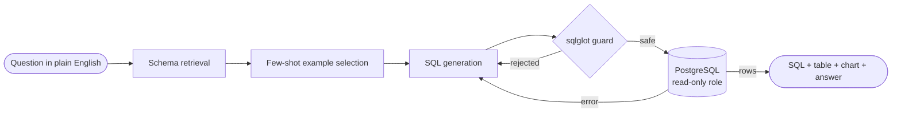

<h1 align="center">Abhishek Bhosale</h1>
<p align="center"><b>Machine Learning • GenAI • Python Backends</b></p>

<p align="center">
  <a href="https://www.linkedin.com/in/abhishek-bhosale-6b0760292/"></a>
  <a href="mailto:abhishekbhosale0511@gmail.com"></a>
  <a href="https://github.com/abh511?tab=repositories"></a>
</p>

---

## 👋 About me

I'm a final-year Computer Engineering student (Honours in Data Science) in Pune. I like projects that are measured against a baseline, tested, and packaged so someone else can actually run them. Lately that means RAG over long documents, LLM agents that write SQL safely, and forecasting models that are evaluated honestly.

```python
abhishek = {
    "based_in":   "Pune, India",
    "studying":   "B.E. Computer Engineering (Hons. Data Science) @ NMIET, SPPU",
    "graduating": 2027,
    "cgpa":       8.57,
    "building":   ["RAG systems", "LLM agents", "ML forecasting", "FastAPI backends"],
    "daily_os":   "Ubuntu",
    "open_to":    "Software / ML / GenAI internships",
}
```

---

## 🚀 Featured projects

### 🗄️ [AskDB](https://github.com/abh511/askDB): ask your database a question in plain English


Type a business question, get back the SQL, a result table, a chart and a one-line answer, over a 9-table e-commerce database in PostgreSQL.

- Only the two generation steps call the LLM; everything else is plain, unit-tested Python
- Four safety layers: a sqlglot guard (single `SELECT`, known tables only), a read-only DB role, a 5 s timeout and a 500-row limit
- 100 hand-checked questions in three difficulty tiers, plus a test that keeps few-shot examples out of the eval set

<details>
<summary><b>How it works</b></summary>
<br/>



</details>

<p>
  
  
  
  
  
  
  
  
  
</p>

---

### 🌍 [EnviroWatch AI](https://github.com/abh511/EAI): environmental risk monitoring and forecasting


A full-stack platform that tracks 7 environmental indicators (air, water, noise, emissions, waste, urban heat, groundwater) across 20 locations in Pune and Mumbai, with alerts, 48-hour forecasts and an interactive risk map.

- Random Forest + XGBoost ensemble that forecasts risk 3 hours ahead, validated on a time split of simulated sensor data
- Anomaly detection that mixes physical-limit rules with an Isolation Forest to flag faulty sensor readings
- Site-suitability engine that scores 12 building types, plus a what-if simulator for traffic, industry and weather
- Supabase PostgreSQL storage with migrations, seeding scripts and a CSV fallback

<p>
  
  
  
  
  
  
</p>

---

### 📚 [AwarePDF](https://github.com/abh511/AwarePDF): a study assistant for engineering textbooks


A RAG assistant for 700+ page textbooks. It answers with page citations and supporting diagrams, and can write chapter summaries, topic outlines and exam key points.

- Hybrid retrieval: dense search + BM25, merged with reciprocal rank fusion, then reranked with a cross-encoder
- Layout-aware ingestion with Docling that keeps section and page metadata and splits tables with repeated headers
- Background diagram captioning with a vision model, and resumable processing keyed by file hash

<p>
  
  
  
  
  
  
  
</p>

---

## 🛠️ Tech stack

| Area | Tools |
|---|---|
| **Languages** | Python, SQL, Java, C++ |
| **Machine Learning** | Scikit-learn, XGBoost, Pandas, NumPy, PySpark, time-series forecasting, anomaly detection |
| **GenAI** | RAG, hybrid search, cross-encoder reranking, text-to-SQL agents, prompt engineering, LLM evaluation, LangChain, ChromaDB, sentence-transformers, Groq |
| **Backend & Data** | FastAPI, PostgreSQL, Supabase, SQLAlchemy, React |
| **Tools** | Linux (Ubuntu), Docker, Git/GitHub, pytest, MLflow, Power BI, Claude Code, ChatGPT, GitHub Copilot |

---

<table>
<tr>
<td valign="top" width="50%">

### 📜 Certifications

- **AI & Data Science**, Drishti CPS (IIT Indore), 2026
- **Python**, Kaggle, 2026
- **SQL**, Intellipaat, 2026

</td>
<td valign="top" width="50%">

### 🤝 Activities

- **Technical Assistant**, Technical Club, NMIET
- **Bootcamp Mentor**: mentored 100+ junior students in programming and problem-solving

</td>
</tr>
</table>

## 🎯 Right now

- 🔬 Running the AskDB evaluation and publishing the accuracy results
- 🌐 Deploying my projects with live demo links
- 💼 Looking for a Software / ML / GenAI internship starting 2027

---

<p align="center"><i>Thanks for stopping by. If a project is useful to you, a ⭐ is appreciated.</i></p>
